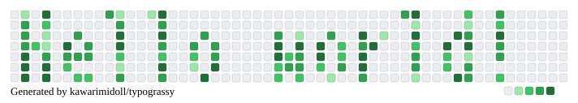

<!--
**kawarimidoll/kawarimidoll** is a ✨ _special_ ✨ repository because its `README.md` (this file) appears on your GitHub profile.

Here are some ideas to get you started:

- 🔭 I’m currently working on ...
- 🌱 I’m currently learning ...
- 👯 I’m looking to collaborate on ...
- 🤔 I’m looking for help with ...
- 💬 Ask me about ...
- 📫 How to reach me: ...
- 😄 Pronouns: ...
- ⚡ Fun fact: ...
-->

Misc

- [Streak Stats](https://streak-stats.demolab.com/?user=kawarimidoll)
- [GitHub Contribution Stats](https://github-contribution-stats.vercel.app/api/?username=kawarimidoll)
- [GitStalk](https://gitstalk.netlify.app/kawarimidoll)
- [GitFolio](https://gitfolio-online.vercel.app/u/kawarimidoll)
- [profile-summary-for-github](https://profile-summary-for-github.com/user/kawarimidoll)

